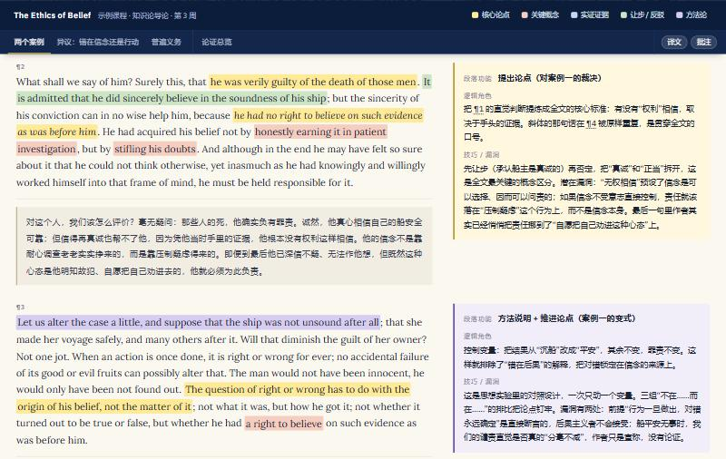

# paper-reader

把一篇英文学术论文做成一个双栏批注 HTML，用来精读：

- **左栏**：英文原文（按五类维度高亮），每段下面紧跟中文译文
- **右栏**：逐段批注，写明段落功能、逻辑角色、论证技巧或潜在漏洞
- **底部**：论证结构总览（问题 → 论点 → 证据 → 反驳 → 结论）、一句话主张、最强处与最弱处



**在线演示**：<https://zy3019.github.io/paper-reader/output/demo-ethics-of-belief.html>（Clifford《The Ethics of Belief》节选，1877 年，公版）。克隆后也可以直接用浏览器打开 `output/demo-ethics-of-belief.html`。

## 怎么用

0. 克隆仓库：

   ```
   git clone https://github.com/zy3019/paper-reader.git
   ```

1. 把论文 PDF 放进 `papers/`。
2. 在这个文件夹里打开 Claude Code（或 Codex），说：

   ```
   批注 papers/xxx.pdf，课程信息：PHIL 2040 知识论 · 第 3 周
   ```

   Claude Code 里也可以用 `/annotate-paper papers/xxx.pdf`。
3. 完成后用浏览器打开 `output/xxx.html`。

不需要 API key，批注由你正在对话的 Claude 或 Codex 完成。需要本机有 Python 3。

## 它是怎么工作的

AI 不直接写 HTML。它写一份纯文本的批注稿，脚本负责排版：

```
papers/xxx.pdf ──extract.py──▶ notes/xxx.source.txt   提取的原文
                                      │  AI 按 GUIDE.md 逐段批注
                                      ▼
                               notes/xxx.md            批注稿
                                      │  build.py + template.html
                                      ▼
                               output/xxx.html         单文件成品
```

这样做有三个好处：每篇论文的版式完全一致；长论文不会因为 AI 要输出大量 HTML 而被缩写；批注稿是普通文本，你觉得哪句译文或批注不好，自己改完重新构建就行。

手动运行：

```
python extract.py papers/xxx.pdf
python build.py notes/xxx.md --source notes/xxx.source.txt
```

`--source` 会把批注稿里的每段英文和提取的原文逐字比对，被改写或漏词的段落会被点名，同时报告批注稿覆盖了原文的多少。

## 页面上能做什么

- 点顶栏的颜色图例：只看这一类高亮，没有这类内容的段落变淡。再点一次恢复。适合先扫一遍论点，或者只核对证据。
- 章节导航条右侧的“译文”“批注”：分别隐藏中文译文和右栏批注，用来自测。
- 批注里的 ¶7 这样的编号可以点，会跳到对应段落。
- 窄屏（手机）自动变成单栏，批注跟在每段后面。

## 文件

| 文件 | 作用 |
|---|---|
| `GUIDE.md` | 给 AI 的工作规范：流程、批注稿格式、高亮和批注的标准。想调整批注风格就改这里。 |
| `template.html` | 页面的样式和交互。想改配色、字号、版式就改这里。 |
| `build.py` | 批注稿 → HTML，并做格式校验和原文核对。 |
| `extract.py` | PDF → 文本。 |
| `CLAUDE.md` / `AGENTS.md` / `.claude/skills/annotate-paper/` | Claude Code 和 Codex 的入口，都指向 `GUIDE.md`。 |
| `notes/demo-ethics-of-belief.md` | 示例批注稿。 |
| `index.html` / `.github/workflows/pages.yml` | 只给 GitHub Pages 用：每次推送到 `main` 时把示例页部署成在线演示，站点根地址跳到示例页。 |

## 说明

- 字体 Lora 和 IBM Plex Sans 从 Google Fonts 加载。断网或加载不了时退回系统字体，版式不受影响。
- 扫描版 PDF 提取不到文字，`extract.py` 会提示。这种情况下 Claude Code 可以直接看 PDF 页面来做，但没法自动核对原文。
- 高亮、译文和批注是 AI 的分析，供精读参考；写作引用时以论文原文为准。
- `papers/`、`notes/`、`output/` 里你自己的内容默认被 `.gitignore` 排除。论文全文有版权，不要把它们推到公开仓库。

## 许可

代码以 MIT 许可发布，见 `LICENSE`。示例文本取自 Wikisource，属公有领域。
